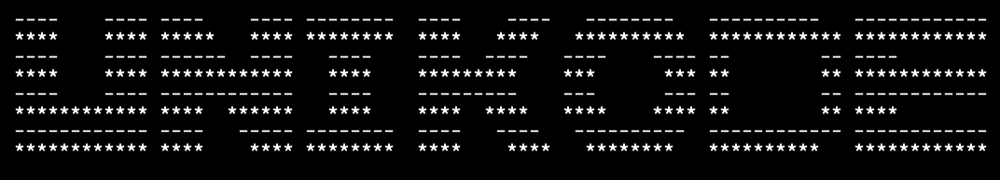
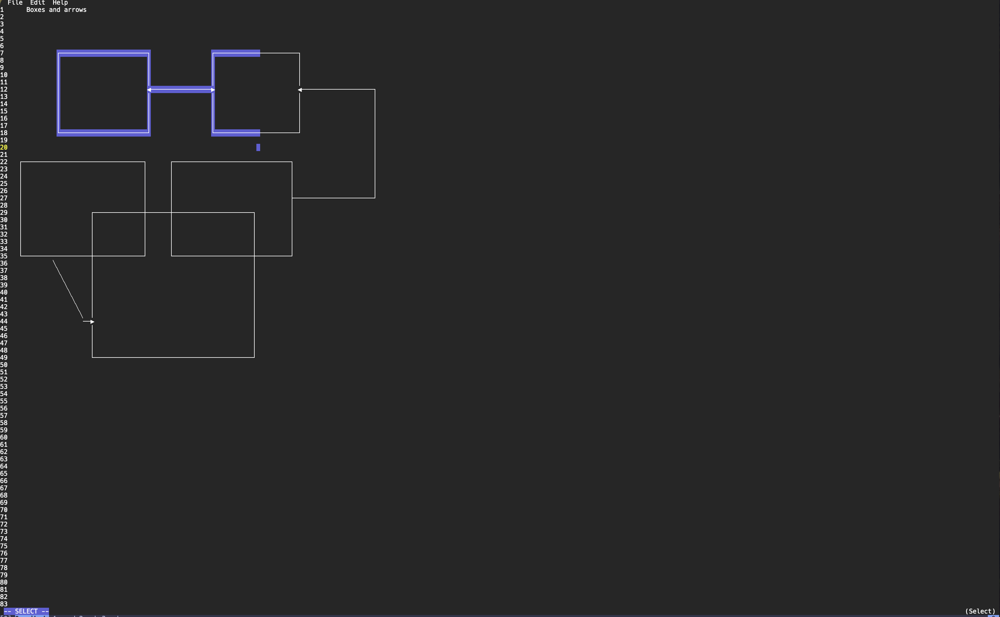

# Unikode

[](LICENSE-MIT)

<p align="center">
  
</p>

## Background

Unikode is a fork of [askii](https://github.com/nytopop/askii) by [nytopop](https://github.com/nytopop). It adds Unicode support, selection and move tools, and terminal interaction changes.

## Screenshot
<p align="center">
  
</p>

## Features

- Terminal interface built with Cursive.
- Draw boxes, arrows, lines, and text.
- Select, move, and erase sections of your diagram.
- Scroll the canvas as the cursor moves.
- Navigate with Vi-style keys (`h`, `j`, `k`, `l`).
- Copy diagrams to your system clipboard.

## Installation

### Prerequisites

Unikode requires the Rust toolchain. If you don't have it, you can install it via [rustup.rs](https://rustup.rs/).

### Build from Source

```bash
git clone https://github.com/stevenp2/unikode.git
cd unikode
cargo install --path .
```
Make sure `~/.cargo/bin` is added to your `$PATH`.

## Usage

Start Unikode by running the binary:

```bash
unikode [filename.txt]
```

### Modes and Tools

Unikode uses a modal editing system. Press the corresponding key to activate a tool.

- **Normal Mode:** The default mode for navigation.
- **Select Mode (`s`):** Click and drag with the left mouse button to define a selection area.
  - **Move (`m`):** While an area is selected, press `m` to enter Move mode. You can move the selection using navigation keys (`h`,`j`,`k`,`l`) or by dragging with the mouse.
    - Press `Enter` to place the characters and restart selection at the new position.
    - Press `m` or `Esc` to place the characters and return to Normal mode.
    - Moves stop at the canvas origin, keeping the selected characters together.
  - **Erase (`e`):** Press `e` to delete all characters within the selection.
- **Box Tool (`b`):** Click and drag to draw a box. The tool automatically handles line joins and corners.
- **Line Tool (`L`):** Click and drag to draw lines.
  - In **Classic** render mode, lines use Unicode box-drawing characters and remain orthogonal.
  - In **Braille** render mode, shape paths use a 2x4 dot raster. Press `p` to switch between **Snap90** (right angles) and **Routed** paths with diagonal support. `p` intentionally has no effect in Classic mode.
- **Arrow Tool (`a`):** Similar to the Line tool, but adds the configured `n`, `s`, `w`, or `e` arrowhead at the destination in both render modes.
- **Text Tool (`t`):** Click anywhere to place a text cursor and start typing. Press `Esc` to commit the text and return to Normal mode.
  - `Enter` inserts a newline; arrow keys move within the draft.

Menu actions that save, copy, open, start a new document, or quit finish the current
edit first. Unsaved changes are checked after that edit is committed.

### Navigation (Outside Text Mode)

- `h`, `j`, `k`, `l`: Move the cursor Left, Down, Up, and Right.
- `0`: Move the cursor to the absolute beginning of the line.
- `^`: Move to the first non-whitespace character on the line.
- `$`: Move to the last non-whitespace character on the line.
- **Numeric Prefixes:** You can prefix movement keys with numbers (e.g., `10j` moves down 10 lines).

### Global Commands

- `u`: Undo the last action.
- `Ctrl + r`: Redo the last undone action.
- `w`: Save the current file.
- `S`: Save As (prompt for a new filename).
- `T`: Trim Margins (removes empty outer space and resets cursor to `0,0`).
- `q`: Quit the application.
- `?`: Show the help overlay.

These are the default bindings. Arrow keys and Page Up/Down scroll the canvas
outside Text mode.

Saving writes a complete temporary file beside the destination, then replaces
the destination. Failed writes keep the document and its history unchanged;
successful whitespace cleanup can be undone. Existing permission bits and
symlink targets are preserved. Replacement changes the inode and does not preserve
hardlink relationships, ownership, ACLs, or extended metadata. The parent directory
is not synced, so replacement is not guaranteed to survive a power failure.

### Configuration

Unikode reads configuration from a TOML file. The following paths are checked in order (first found wins):

1. `~/.config/unikode/unikode.toml` (XDG-style, recommended)
2. `./unikode.toml` (local, in working directory)

See the included [`unikode.toml`](unikode.toml) for all available options with their defaults. The config supports `[editor]`, `[colors]`, `[symbols]`, and `[keys]` sections.

Choose the renderer in `[editor]`:

```toml
render_mode = "classic" # or "braille"
path_mode = "snap90"    # or "routed"; routed is active only in Braille mode
```

The same renderer can be selected for one invocation with
`unikode --render-mode braille [filename.txt]`. A document does not store mode
metadata: existing characters are left unchanged, and the selected mode applies
to newly drawn boxes, lines, and arrows.

## License

This project is licensed under the MIT License - see the [LICENSE-MIT](LICENSE-MIT) file for details.

## Development

Unikode is split into a reusable editor library and a Cursive adapter. Cursive
events are translated into application actions and editor commands, so the real
UI and headless tests use the same update and transaction-history path.
`editor` owns committed rows, document I/O, selection operations, and history.
`tui/session.rs` owns a typed interaction state for drawing, selecting, moving,
and text entry; `tui/controller.rs` handles viewport coordinates, scrolling, and
panning. Rendering, dialogs, colors, and clipboard access also live under `tui`.
Coordinate and region types live under `core`; routing and glyph joins belong to
`drawing`.
Drawing requests are planned once as polylines and then composed by the Classic
or Braille backend, so previews and committed commands use identical geometry.
Integration tests exercise editor workflows, file I/O, configuration precedence,
CLI behavior, and a dummy terminal backend.

`EditorView::read()` and `write()` return mapped parking_lot guards to the editor.
Callers that explicitly name the previous guard types must update those annotations.
The unused exported `simple_display!` macro was removed with the old tool layer.

The project selects the stable Rust channel in `rust-toolchain.toml`. Run the full
local quality gate with:

```bash
cargo fmt --all -- --check
cargo clippy --all-targets --all-features -- -D warnings
cargo test --all-targets --locked
cargo doc --no-deps
```
